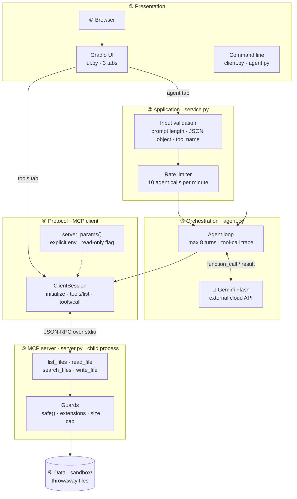
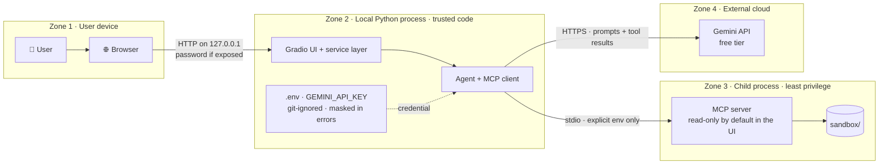
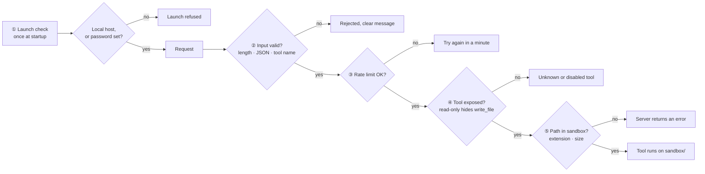
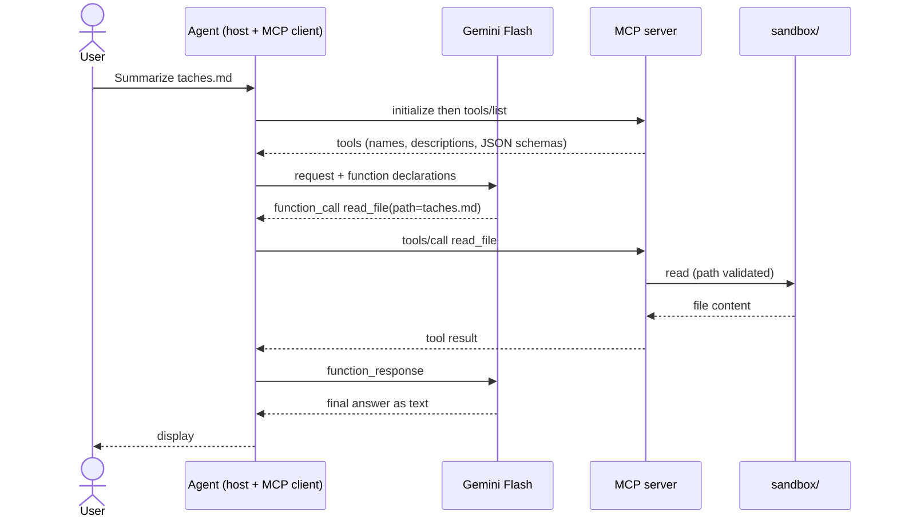

# mayerfeld-mcp-demo

A hands-on demo of the **Model Context Protocol (MCP)** for **mayerfeld.consulting**: a sandboxed MCP file server, a minimal client that shows the raw protocol, a **Gemini Flash agent** (Google's free API tier) that chooses which tools to call on its own, and a **Gradio web interface** to test everything from a browser.

> ⚠️ **Throwaway data only.** The server only exposes `MCP_SANDBOX_DIR` (default `./sandbox`) and rejects any path outside it. Never point it at real files, and only send disposable data to the free API tier (see [Limits of the free tier](#limits-of-the-free-tier-gemini)).

## Architecture

### 1. Layered view

Each layer talks only to the one below it, and each layer owns one responsibility. The user interface contains **display code only**: all logic and security live in the service layer, which is why it can be tested without a browser.



| Layer | Files | Responsibility |
|---|---|---|
| ① Presentation | `ui.py`, `client.py`, `agent.py` (CLI entry points) | Display and user input. No business logic |
| ② Application | `service.py` | Validation, rate limiting, launch checks, secret redaction, error mapping |
| ③ Orchestration | `agent.py` | The agent loop: send tools and request to Gemini, run each `function_call`, feed results back |
| ④ Protocol | `ClientSession` (`mcp` SDK), `client.server_params()` | MCP connection; builds the server launch environment explicitly |
| ⑤ MCP server | `server.py` | Exposes the tools; enforces the path guard, extension allow-list, size cap and read-only mode |
| ⑥ Data | `sandbox/` | Fake files read and written by the tools |

### 2. Trust boundaries and data flows

Four zones, each with a different level of trust. The most important thing to notice: **file contents read by a tool travel to Google** as part of the conversation, which is why only throwaway data belongs in the sandbox.



| Boundary | What crosses it | Protection |
|---|---|---|
| Browser → UI | Requests | Local-only by default; password mandatory when `UI_HOST` is not local |
| UI → MCP server | Tool calls | Explicit environment only (sandbox path, read-only flag); no inherited secrets |
| Agent → Gemini | Prompts, tool results, the API key as credential | HTTPS; only disposable data in the sandbox; key never displayed |

### 3. Defence in depth

A request has to pass several independent checks before it can touch a file. Any one of them can stop it.



### 4. One agent turn, step by step



The protocol does not pick the tool: **the model does**, based on the names, descriptions and schemas it receives. Every tool call is printed on `stderr` as `[outil] name(args)` and shown in the UI trace.

### 5. Design decisions

| Decision | Why | Trade-off |
|---|---|---|
| **stdio transport** | Simplest and safest for a local demo: no network port, no authentication to design | Local only; a remote deployment needs an HTTP transport |
| **UI is display-only; logic in `service.py`** | Testable without a browser; security rules in one place | One extra module |
| **Gradio instead of Streamlit** | Event-driven and async-friendly; Streamlit reruns the script on each click, which clashes with an async stdio session | Less layout freedom |
| **One server process per UI action** | Stateless and simple: nothing to keep alive or clean up | Slightly slower per click |
| **Read-only by default in the UI** | The model cannot write because the tool does not exist | Writing requires an explicit opt-in |
| **Explicit environment for the child process** | The MCP SDK only passes a minimal default environment; being explicit makes the sandbox and read-only settings reliable | None |
| **Real errors surfaced** | Errors raised inside the session arrive wrapped in an `ExceptionGroup`; the code unwraps them so you see the real cause (e.g. Gemini 503) | None |

### 6. Robustness: what happens when things go wrong

| Situation | Behaviour |
|---|---|
| Gemini returns `503`, `429` or `404` | The real error is shown (no automatic retry yet: see [Roadmap](#roadmap)) |
| Invalid JSON arguments or unknown tool | Rejected before reaching the server, with a clear message |
| Path outside the sandbox, bad extension, oversize write | Refused by the server, returned as a tool error |
| Model loops on tool calls | Stopped after 8 turns |
| Too many agent requests | Refused for a minute (protects the free quota) |
| API key appears in an error message | Masked before display |
| UI exposed to the network without a password | Launch refused |

## Components

| Component | File | Role |
|---|---|---|
| **Web interface** | `src/mayerfeld_mcp/ui.py` | Gradio screens: tool tester, agent, sandbox viewer. Display only |
| **Service layer** | `src/mayerfeld_mcp/service.py` | Logic and security for the UI |
| **Host / agent** | `src/mayerfeld_mcp/agent.py` | Agent loop with Gemini |
| **LLM-free client** | `src/mayerfeld_mcp/client.py` | Raw protocol demo; builds the server launch parameters; unwraps errors |
| **MCP server** | `src/mayerfeld_mcp/server.py` | Tools and guards |
| **Sandbox** | `sandbox/` | Fake data |

## Repository layout

```
mayerfeld-mcp-demo/
├── src/mayerfeld_mcp/
│   ├── server.py      # MCP server (FastMCP): tools + guards
│   ├── client.py      # minimal MCP client + server launch parameters
│   ├── agent.py       # Gemini agent wired to the server
│   ├── service.py     # UI logic + security (testable without a browser)
│   └── ui.py          # Gradio interface
├── sandbox/           # fake demo data
├── tests/             # end-to-end, security, service, agent and UI tests
├── docs/FICHE_TECHNIQUE_DEMO.md
├── .github/workflows/ci.yml
├── .env.example
└── pyproject.toml
```

## Quick start

Requirements: Python ≥ 3.10.

```bash
python -m venv .venv
```

Activate the virtual environment:

```bash
# macOS / Linux
source .venv/bin/activate

# Windows (PowerShell)
.venv\Scripts\Activate.ps1
```

Then install and test:

```bash
pip install -e ".[dev,agent,ui]"
pytest -q
```

You should see **21 passed**. Run everything from the repository root, so the server finds `sandbox/`.

## Demo 1: raw protocol (no LLM, no API key)

```bash
python -m mayerfeld_mcp.client
```

## Demo 2: Gemini Flash agent (free tier)

1. **Create an API key** in [Google AI Studio](https://aistudio.google.com) (menu "Get API key").
2. **Set up the environment**:
   ```bash
   cp .env.example .env        # Windows: copy .env.example .env
   # then fill in GEMINI_API_KEY and GEMINI_MODEL in .env
   ```
3. **Pick a Flash model.** Model names change often. Check the [models list](https://ai.google.dev/gemini-api/docs/models) and the [pricing page](https://ai.google.dev/gemini-api/docs/pricing) to confirm it is available on the free tier, then set `GEMINI_MODEL`. The default (`gemini-2.5-flash`) may have been retired: on a 404 error, change this variable.
4. **Run the agent**:
   ```bash
   mayerfeld-mcp-agent "List my files and summarize taches.md"
   ```
   If the command is not found, use: `python -m mayerfeld_mcp.agent "..."`.

## Demo 3: web interface (Gradio)

```bash
mayerfeld-mcp-ui
```

Then open <http://127.0.0.1:7860>. If the command is not found, use `python -m mayerfeld_mcp.ui`.

| Tab | What it does |
|---|---|
| **1 · MCP tools (no AI)** | Runs `tools/list`, shows each tool's JSON schema, lets you call a tool with JSON arguments (`tools/call`) |
| **2 · Gemini agent** | Sends a request to the agent and shows the answer plus the **trace of every real tool call** |
| **3 · Sandbox** | Lists and opens the files in `sandbox/`, to check the real effects of the tools |

The checkbox at the top (**read-only mode, on by default**) removes `write_file` from the server, so neither you nor the model can write.

## Security

The layers are shown in [Defence in depth](#3-defence-in-depth). In detail:

| Measure | Where | Effect |
|---|---|---|
| Local-only by default | `ui.py` | Listens on `127.0.0.1`; `share=True` (public Gradio link) is never used |
| Password for network exposure | `service.validate_launch` | If `UI_HOST` is not local, `UI_USERNAME` and `UI_PASSWORD` are mandatory (8+ characters), otherwise the launch is refused |
| Read-only mode | `server.py` | `write_file` is not registered, so it cannot be called or suggested to the model |
| Path guard | `server._safe` | Any path resolving outside `sandbox/` is rejected (including `../` and symlinks) |
| Write limits | `server.py` | Only `.txt .md .json .csv`, at most 100 KB |
| Input validation | `service.py` | Prompt length cap, JSON-object-only arguments, tool name checked against the discovered list |
| Rate limit | `service.RateLimiter` | 10 agent calls per minute, to protect the free quota |
| Secret hygiene | `service.redact` | The API key is never displayed and is masked in error messages; `.env` is git-ignored |

The built-in password is a basic protection for a demo: it sends credentials over plain HTTP. If you expose the UI beyond your machine, put it behind HTTPS (reverse proxy) and a stronger authentication.

**Prompt injection:** a file the agent reads can contain instructions aimed at the model ("now write...", "now read..."). Read-only mode and the guards above limit the damage, which is why read-only is the default in the UI.

### How to check the tools really work

- The **`[outil] ...` lines** (terminal) or the **trace** (UI) prove a tool was actually called. Without them, the model answered on its own.
- **Check the side effects** in the Sandbox tab, or with `Create a file test.txt containing: hello MCP`.
- **Check the refusals**: ask `Read the file ../pyproject.toml`. The server must reject it.

### Limits of the free tier (Gemini)

- **Quotas** depend on the model, apply per project and can change. Exact values are on the [official rate-limits page](https://ai.google.dev/gemini-api/docs/rate-limits); figures quoted by third-party articles disagree. A `429` or `RESOURCE_EXHAUSTED` error means the quota is reached; a `503` means the model is overloaded (try again later).
- **Privacy**: according to secondary sources, content sent on the free tier may be used to improve Google products. Check the official terms, and only send disposable data.
- **Key safety**: never commit `.env` (already in `.gitignore`), and keep `.env.example` free of real values.

## Configuration

| Variable | Default | Purpose |
|---|---|---|
| `GEMINI_API_KEY` | (empty) | Google AI Studio key |
| `GEMINI_MODEL` | `gemini-2.5-flash` | Flash model name (check availability) |
| `MCP_SANDBOX_DIR` | `./sandbox` | Folder exposed by the server |
| `MCP_READ_ONLY` | `0` | `1` hides `write_file` (CLI client and agent) |
| `UI_HOST` / `UI_PORT` | `127.0.0.1` / `7860` | Where the UI listens |
| `UI_USERNAME` / `UI_PASSWORD` | (empty) | Required when `UI_HOST` is not local |

## Troubleshooting

| Symptom | Likely cause and fix |
|---|---|
| `GEMINI_API_KEY manquante` | `.env` is not at the repository root, or the key is empty |
| Gemini error `503` | The model is overloaded on Google's side: retry later or change `GEMINI_MODEL` |
| Gemini error `404` | The model in `GEMINI_MODEL` no longer exists: pick a current Flash model |
| Gemini error `429` / `RESOURCE_EXHAUSTED` | Free-tier quota reached: wait or change model |
| `Lancement refusé : UI_HOST=...` | You bound the UI to the network without `UI_USERNAME` / `UI_PASSWORD` |
| `ImportError` on `mcp.server.fastmcp` | You installed `mcp` 2.x: reinstall with `pip install -e ".[dev,agent,ui]"` (pinned to `<2`) |
| `ModuleNotFoundError: gradio` | Install the UI extra: `pip install -e ".[ui]"` |
| Garbled accents on Windows | Set `$env:PYTHONUTF8=1` (PowerShell), then rerun |
| `pytest: not found` | The virtual environment is not activated |

## Using the server from another MCP client

Stdio command: `python -m mayerfeld_mcp.server`, with the `MCP_SANDBOX_DIR` (and optionally `MCP_READ_ONLY`) environment variables. The configuration format depends on the client: check your client's current documentation.

## Tests and status

| Item | Status |
|---|---|
| Server and tools (discovery, read, write, search) | ✅ tested |
| Sandbox escape, bad extension, oversize write blocked | ✅ tested |
| Read-only mode hides `write_file` | ✅ tested |
| UI service layer (validation, rate limit, launch checks, redaction) | ✅ tested |
| Real errors surfaced instead of `ExceptionGroup` | ✅ tested |
| UI starts, password enforced (401 without credentials), tools usable over HTTP | ✅ tested (script, Linux) |
| Agent loop with a **fake** Gemini client | ✅ tested |
| Real Gemini API call with a real key (CLI) | ✅ tested manually |
| Real Gemini call **from the web UI** | ⚠️ to check manually |
| UI rendering in a browser (layout, Windows) | ⚠️ to check manually |

## Roadmap

Not implemented yet, in rough priority order:

1. **Automatic retry with backoff** on Gemini `503` / `429`.
2. **Remote deployment**: HTTP transport, proper authentication, HTTPS.
3. **Human confirmation** before each write, instead of the all-or-nothing read-only switch.
4. **Audit log** of tool calls (who, what, when).

## Versions

- `mcp>=1.2,<2`: the Python SDK v2 renames `FastMCP` to `MCPServer` and changes other APIs. Tested: 1.30.0.
- `google-genai>=2,<3`: tested: 2.30.1.
- `gradio>=6,<7`: tested: 6.30.0.

## Limitations

- **stdio transport only** (local). A remote deployment would need an HTTP transport, proper authentication and a security review.
- The UI starts one server process per action (simple and stateless, slightly slower).
- No per-action human confirmation before `write_file`: read-only mode is the safeguard.

## License

MIT License. See [LICENSE](LICENSE).
