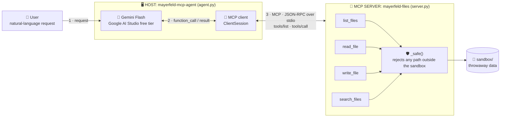
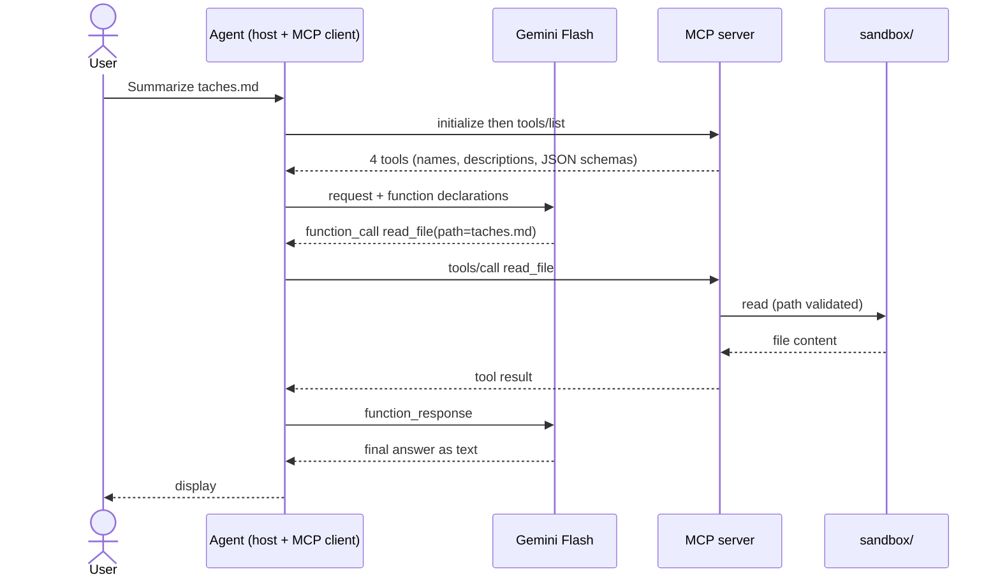

# mayerfeld-mcp-demo

A hands-on demo of the **Model Context Protocol (MCP)** for **mayerfeld.consulting**: a sandboxed MCP file server, a minimal client that shows the raw protocol, and a **Gemini Flash agent** (Google's free API tier) that chooses which tools to call on its own.

> ⚠️ **Throwaway data only.** The server only exposes `MCP_SANDBOX_DIR` (default `./sandbox`) and rejects any path outside it. Never point it at real files, and only send disposable data to the free API tier (see [Limits of the free tier](#limits-of-the-free-tier-gemini)).

## Architecture



| Component | File | Role |
|---|---|---|
| **Host / agent** | `src/mayerfeld_mcp/agent.py` | Loop: sends the tools and the request to Gemini, runs each `function_call` through MCP, feeds the results back |
| **MCP client** | `ClientSession` (`mcp` SDK) | Keeps the connection to the server: `initialize`, `tools/list`, `tools/call` |
| **LLM-free client** | `src/mayerfeld_mcp/client.py` | Same protocol, no model: ideal to show the raw protocol |
| **MCP server** | `src/mayerfeld_mcp/server.py` | Exposes 4 tools over stdio, with a path-traversal guard |
| **Sandbox** | `sandbox/` | Fake data read and written by the tools |

### One agent turn, step by step



The protocol does not pick the tool: **the model does**, based on the names, descriptions and schemas it receives. Every tool call is printed on `stderr` as `[outil] name(args)`, which is handy for a live demo.

## Repository layout

```
mayerfeld-mcp-demo/
├── src/mayerfeld_mcp/
│   ├── server.py      # MCP server (FastMCP): 4 tools + guard
│   ├── client.py      # minimal MCP client, no LLM
│   └── agent.py       # Gemini agent wired to the server
├── sandbox/           # fake demo data
├── tests/             # end-to-end tests + agent loop (fake client)
├── .github/workflows/ci.yml
├── .env.example
└── pyproject.toml
```

## Quick start

Requirements: Python ≥ 3.10.

```bash
python -m venv .venv
```

Activate the virtual environment:

```bash
# macOS / Linux
source .venv/bin/activate

# Windows (PowerShell)
.venv\Scripts\Activate.ps1
```

Then install and test:

```bash
pip install -e ".[dev,agent]"
pytest -q
```

You should see **5 passed**. Run everything from the repository root, so the server finds `sandbox/`.

## Demo 1: raw protocol (no LLM, no API key)

```bash
python -m mayerfeld_mcp.client
```

Prints the discovered tools, then the results of `list_files` and `search_files`.

## Demo 2: Gemini Flash agent (free tier)

1. **Create an API key** in [Google AI Studio](https://aistudio.google.com) (menu "Get API key").
2. **Set up the environment**:
   ```bash
   cp .env.example .env        # Windows: copy .env.example .env
   # then fill in GEMINI_API_KEY and GEMINI_MODEL in .env
   ```
3. **Pick a Flash model.** Model names change often. Check the [models list](https://ai.google.dev/gemini-api/docs/models) and the [pricing page](https://ai.google.dev/gemini-api/docs/pricing) to confirm it is available on the free tier, then set `GEMINI_MODEL`. The default in the code (`gemini-2.5-flash`) may have been retired: on a 404 error, just change this variable.
4. **Run the agent**:
   ```bash
   mayerfeld-mcp-agent "List my files and summarize taches.md"
   ```
   If the command is not found, use: `python -m mayerfeld_mcp.agent "..."`.

### How to check the tools really work

- The **`[outil] ...` lines** in the terminal prove a tool was actually called. Without them, the model answered on its own.
- **Check the side effects**: ask for `Create a file test.txt containing: hello MCP`, then open `sandbox/test.txt`.
- **Check the refusals**: ask `Read the file ../pyproject.toml`. The server must reject it as outside the sandbox.

### Limits of the free tier (Gemini)

- **Quotas** depend on the model, apply per project and can change. Exact values are on the [official rate-limits page](https://ai.google.dev/gemini-api/docs/rate-limits); figures quoted by third-party articles disagree, so don't rely on them. A `429` or `RESOURCE_EXHAUSTED` error means the quota is reached: wait a bit or switch model.
- **Privacy**: according to secondary sources, content sent on the free tier may be used to improve Google products. Check the official terms, and only send disposable data.
- **Key safety**: never commit `.env` (it is already in `.gitignore`), and keep `.env.example` free of real values.

## Troubleshooting

| Symptom | Likely cause and fix |
|---|---|
| `GEMINI_API_KEY manquante` | `.env` is not at the repository root, or the key is empty |
| Error `404` from the Gemini API | The model in `GEMINI_MODEL` no longer exists: pick a current Flash model |
| Error `429` / `RESOURCE_EXHAUSTED` | Free-tier quota reached: wait or change model |
| `ImportError` on `mcp.server.fastmcp` | You installed `mcp` 2.x: reinstall with `pip install -e ".[dev,agent]"` (pinned to `<2`) |
| Garbled accents on Windows | Set `$env:PYTHONUTF8=1` (PowerShell), then rerun |
| `pytest: not found` | The virtual environment is not activated |

## Using the server from another MCP client

Stdio command: `python -m mayerfeld_mcp.server`, with the `MCP_SANDBOX_DIR` environment variable. The configuration format depends on the client: check your client's current documentation.

## Tests and status

| Item | Status |
|---|---|
| Server and 4 tools (discovery, read, write, search) | ✅ tested |
| Sandbox escape blocked (`../../etc/passwd`) | ✅ tested |
| LLM-free client | ✅ tested |
| Agent loop with a **fake** Gemini client | ✅ tested |
| Real Gemini API call with a real key | ✅ tested |

Automated tests (`pytest`) cover the server and the agent loop with a fake client. The real Gemini call was checked manually and is not part of the test suite, because it needs a key and a network.

## Versions

- `mcp>=1.2,<2`: the Python SDK v2 renames `FastMCP` to `MCPServer` and changes other APIs. Version used for testing: 1.30.0.
- `google-genai>=2,<3`: version used for testing: 2.30.1.

## Limitations

- **stdio transport only** (local). A remote deployment would need an HTTP transport, authentication and a security review.
- No human confirmation before `write_file`: add one for any real use.

## License

Copyright (c) 2026 Ferol Tatang