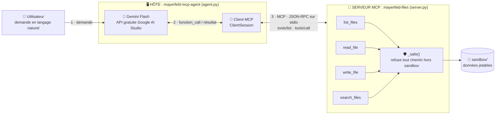
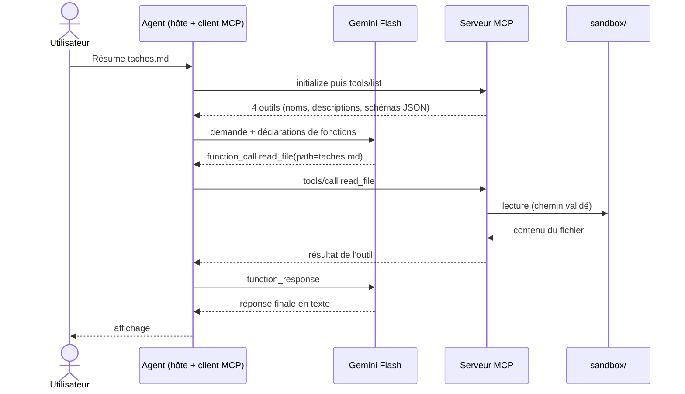

# mayerfeld-mcp-demo

Démo de **MCP (Model Context Protocol)** pour **mayerfeld.consulting** : un serveur MCP qui expose un dossier *sandboxé* sous forme d'outils, un client minimal qui montre le protocole brut, et un **agent Gemini Flash** (API gratuite de Google) qui choisit lui-même les outils à appeler.

> ⚠️ **Données jetables uniquement.** Le serveur n'expose que `MCP_SANDBOX_DIR` (défaut `./sandbox`) et refuse toute sortie de ce dossier. Ne le pointe jamais vers de vrais fichiers, et n'envoie à l'API gratuite que des données sans importance (voir [Limites de l'offre gratuite](#limites-de-loffre-gratuite-gemini)).

## Architecture



| Composant | Fichier | Rôle |
|---|---|---|
| **Hôte / agent** | `src/mayerfeld_mcp/agent.py` | Boucle : envoie les outils et la demande à Gemini, exécute les `function_call` via MCP, renvoie les résultats |
| **Client MCP** | `ClientSession` (SDK `mcp`) | Maintient la connexion avec le serveur : `initialize`, `tools/list`, `tools/call` |
| **Client sans LLM** | `src/mayerfeld_mcp/client.py` | Même protocole, sans modèle : idéal pour montrer le protocole brut |
| **Serveur MCP** | `src/mayerfeld_mcp/server.py` | Expose 4 outils sur stdio, avec garde-fou anti-évasion de chemin |
| **Sandbox** | `sandbox/` | Données fictives lues et écrites par les outils |

### Déroulé d'un tour d'agent



Le protocole ne choisit pas l'outil : **c'est le modèle** qui décide, d'après les noms, descriptions et schémas reçus. Chaque appel d'outil est affiché sur `stderr` (`[outil] nom(args)`), pratique pour la démo en direct.

## Structure du dépôt

```
mayerfeld-mcp-demo/
├── src/mayerfeld_mcp/
│   ├── server.py      # serveur MCP (FastMCP) : 4 outils + garde-fou
│   ├── client.py      # client MCP minimal, sans LLM
│   └── agent.py       # agent Gemini branché sur le serveur
├── sandbox/           # données fictives de la démo
├── tests/             # tests de bout en bout + boucle agent (faux client)
├── .github/workflows/ci.yml
├── .env.example
└── pyproject.toml
```

## Installation

Prérequis : Python ≥ 3.10.

```bash
python -m venv .venv && source .venv/bin/activate
pip install -e ".[dev,agent]"
pytest -q
```

## Démo 1 : protocole brut (sans LLM, sans clé API)

À lancer depuis la racine du dépôt :

```bash
python -m mayerfeld_mcp.client
```

Affiche les outils découverts, puis un `list_files` et un `search_files`.

## Démo 2 : agent Gemini Flash (offre gratuite)

1. **Crée une clé** dans [Google AI Studio](https://aistudio.google.com) (menu « Get API key »).
2. **Configure l'environnement** :
   ```bash
   cp .env.example .env
   # renseigne GEMINI_API_KEY et GEMINI_MODEL dans .env
   ```
3. **Choisis un modèle Flash** : les noms changent souvent. Consulte la [liste des modèles](https://ai.google.dev/gemini-api/docs/models) et la [page des tarifs](https://ai.google.dev/gemini-api/docs/pricing) pour confirmer qu'il est disponible en offre gratuite, puis mets-le dans `GEMINI_MODEL`. Le défaut du code (`gemini-2.5-flash`) peut avoir été retiré : en cas d'erreur 404, change simplement cette variable.
4. **Lance l'agent** :
   ```bash
   mayerfeld-mcp-agent "Liste mes fichiers et résume taches.md"
   ```

### Limites de l'offre gratuite (Gemini)

- **Quotas** : ils dépendent du modèle, s'appliquent par projet et peuvent changer. Les valeurs exactes sont sur la [page officielle des limites](https://ai.google.dev/gemini-api/docs/rate-limits) ; les chiffres cités par des articles tiers divergent, donc ne t'y fie pas. Une erreur `429` ou `RESOURCE_EXHAUSTED` signifie quota atteint : attends un peu ou change de modèle.
- **Confidentialité** : d'après des sources secondaires, les contenus envoyés en offre gratuite peuvent servir à améliorer les produits Google. Vérifie les conditions officielles, et n'envoie que des données jetables.
- **Sécurité de la clé** : ne commite jamais `.env` (déjà dans `.gitignore`).

## Utiliser le serveur depuis un autre client MCP

Commande stdio : `python -m mayerfeld_mcp.server`, avec la variable `MCP_SANDBOX_DIR`. Le format de configuration dépend du client : vérifie la documentation actuelle de ton client.

## Tests et statut

| Élément | Statut |
|---|---|
| Serveur et 4 outils (découverte, lecture, écriture, recherche) | ✅ testé |
| Blocage de la sortie du sandbox (`../../etc/passwd`) | ✅ testé |
| Client sans LLM | ✅ testé |
| Boucle de l'agent avec un **faux** client Gemini | ✅ testé |
| Appel réel à l'API Gemini avec une vraie clé | ✅ testé |

## Versions

- `mcp>=1.2,<2` : la v2 du SDK Python renomme `FastMCP` en `MCPServer` et change d'autres API. Version utilisée pour les tests : 1.30.0.
- `google-genai>=2,<3` : version utilisée pour les tests : 2.30.1.

## Limites

- Transport **stdio** uniquement (local). Un déploiement distant demanderait un transport HTTP, de l'authentification et une revue de sécurité.
- Pas de confirmation humaine avant `write_file` : à ajouter pour tout usage réel.

## Licence

À choisir avant publication.